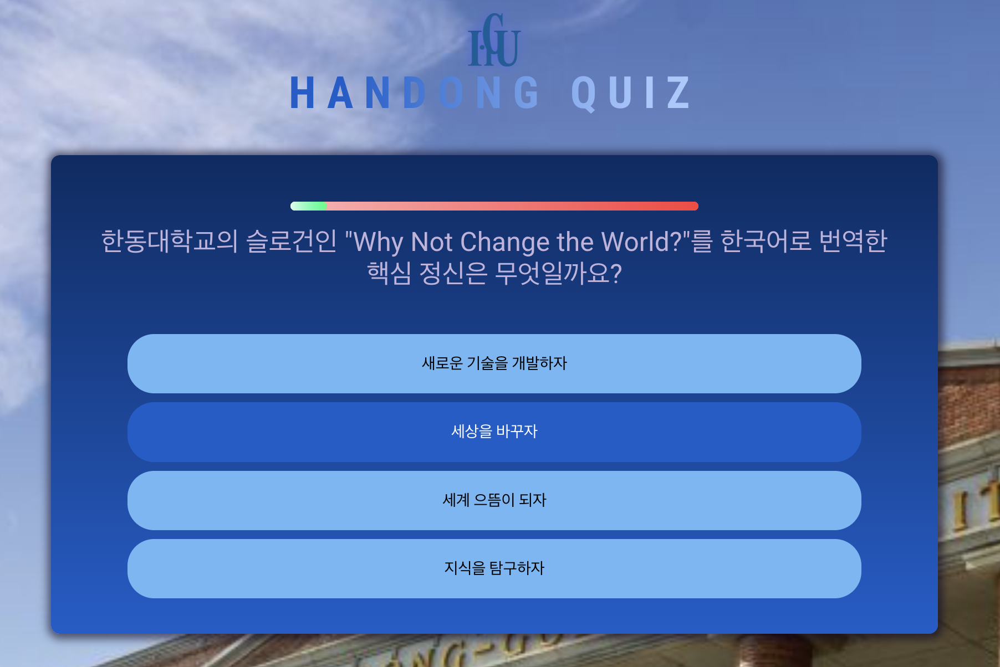

# React Quiz App

## Project Information: 프로젝트 소개, 선택 이유, 원본 GitHub URL 및 라이선스
프로젝트 소개: 타이머가 정해진 한동에 관한 퀴즈를 풀 수 있는 React 프로젝트     

선택 이유: 퀴즈가 재미있어 보였으며 간단한 UI와 구성일 것으로 예상하여 첫 React 프로젝트로 적합할 것이라 판단함

원본 GitHub URL: https://github.com/HH00254/React-Quiz-App

## Installation: 설치·실행 방법 및 실행 화면
설치 및 실행 방법:

npm install     
npm run dev

실행 화면: 

## Source Code Exploration: 주요 파일, 컴포넌트, 코드 분석
주요 파일
* index.html
* main.jsx
* App.jsx
* index.css
* question.js
* package.json 

컴포넌트
* Answer.jsx
* Header.jsx
* Question.jsx
* Questions.jsx
* Quiz.jsx
* Summary.jsx

코드 분석:
Quiz.jsx는 전체적인 퀴즈의 흐름 상태, Questions.jsx는 퀴즈를 화면에 나타내고 사용자가 선택한 값을 받아서 Question.jsx에서 판별을 하고 Summary.jsx에서 최종 결과 확인

## Customizing: 수정한 3가지 내용, 수정 파일명 및 전/후 결과
퀴즈내용, 디자인, 버튼 추가     
questions.js에 있는 퀴즈 내용들을 한동관련 내용으로 바꿈    
index.css에 있는 이미지, 글꼴 색상, 프로그레스 바 색상 변경
Summary.jsx에 다시하기(화면 새로고침) 버튼 추가

## Deployment: 실제 접근 가능한 Vercel URL
https://react-quiz-app10.vercel.app/

## Weekly Review:
### 새롭게 배운 내용 3가지
1. React 프로젝트에서는 하나의 javascript에 코드를 다 작성하지 않고 component로 나누어 작성함
2. node_modules는 npm install을 하면서 생성할 수 있음
3. 

### 어려웠던 점과 해결 방법
처음 React 프로젝트를 접하는 것에 비해 component가 많고 이름도 비슷해서 코드를 어느 부분을 수정해야하는지 헷갈림
AI활용 

### AI 활용 내용 및 느낀 점
퀴즈 내용 변환하는 곳이 question.js에 따로있는 것을 AI를 통해 발견함
코드를 수정해야하는 위치를 찾는데에 AI가 참 유용한 것 같음